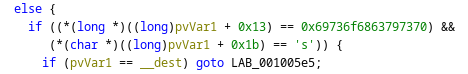

# Cyberpsychosis

hola aqui sp00nki  de vuelta , este sera mi primer post de writeup aqui en el blog , y que mejor empezar con un resumen de como analize un madafakin rootkit .

honestamente me costo un monton , no soy tan bueno en reversing , pero me da un auraaa increible hjahah , es muy interesante como llegas a tocar las entrañas de un programa para entender el por que o que hace , mientras caes en la demencia .

pero como siempre digo , "Romper cosas para ver cómo funcionan es la forma más pura de curiosidad"

ahora bien , eleji este reto , por que me ayudo a comprender mucho , como es que logran identificar y averiguar su funcionalidad con estos tipos de malware.


capitulo 1&#x20;

saque este reto de la plataforma Hack the box , y es de nivel facil jajaj yo me lo quise complicar hahah .&#x20;

pero valio totalmente la pena .


<figure><figcaption></figcaption></figure>

bien el reto nos da un archivo con un nombre raro y que esta en formato zip , lo que hice primeramente es descomprimirlo y me da 2 archivos licence.txt y diamorphine.ko

posteriormente identificamos que tipo de archivo es , por que para este punto no conocia la extencion .ko

<figure><figcaption></figcaption></figure>

investigando un poco me di con la sorpresa de que era un kernel object , y cai en cuenta de que no era tan facil como parecia hahah , peeeero  al final investigando entendi que son los archivos necesarios para el funcionamiento de un modulo de kernel , y que su ves un modulo de kernel es un complemento que necesita el kernel para la comunicacion entre la capa 3 y 0 del sistema de seguridad del sistema operativos o como se le dices anillo de seguridad  , es algo confuso cuando no entiendes como funciona el sistema a bajo nivel jajaja pero ey lo aprendes en unas horas , almenos eso fue lo que hice yo hahah .

bueno continuando lo siguiente que analize fue ver su metadata del archivo binario ELF , osea que tendremos que ver si tienen sus funciones sin ofuscar y son legibles .

<figure><figcaption></figcaption></figure>

lo mas relevante de todo esto por que se que es confuso para los novatos jaja , vemos funciones y variables con sus funciones con su nombre sin ser ofuscados , eso es bueno por que podemos entender mejor el codigo o saber por donde buscar el rootkit .

para verlo mejor podemos decompilarlo a lenguaje c para que sea mas entedible con la poderosimia ghidra.

<figure><figcaption></figcaption></figure>

ahi se nos lista las funciones con mas claridad . por los nombres nos podemos guiar de cuales funciones pueros remplazadas por el atacante , tenemos .

| Símbolo                                 | Tipo         | Qué nos dice                                                             |
| --------------------------------------- | ------------ | ------------------------------------------------------------------------ |
| `hacked_kill`                           | FUNC         | Reemplaza al syscall `kill` (envío de señales)                           |
| `hacked_getdents` / `hacked_getdents64` | FUNC         | Reemplazan a los syscalls que listan directorios (`ls`, `find`)          |
| `give_root`                             | FUNC         | Escalada de privilegios                                                  |
| `module_hide` / `module_show`           | FUNC         | Ocultar / mostrar el módulo en `lsmod`                                   |
| `find_task` / `is_invisible`            | FUNC         | Gestión de procesos invisibles                                           |
| `orig_kill`, `orig_getdents*`           | OBJECT       | Punteros a los syscalls originales (guardados antes de hookear)          |
| `module_hidden`                         | OBJECT       | Flag de estado: ¿está oculto el módulo?                                  |
| `prepare_creds`, `commit_creds`         | UND (import) | Funciones del kernel para cambiar credenciales → confirman escalada real |

una cosa que olvide mencionar es que los que secuestra el rootkit (hookea) son los syscalls , que son? pues  son las **llamadas al sistema** que usan internamente programas como `ls`, `find` o `readdir` para listar un directorio.&#x20;

entonces sabiendo esto nos adentramos en el hook de hacked\_getdents , y analizando ese syscall vemos que hay un valor inmediato en litle endian

<figure><figcaption></figcaption></figure>

vemos un valor en hexadecimal 0x69736f6863797370 , si los separamos de par de numeros  y eliminamos el prefijo 0x

tenemos la siguiente secuencia y si lo pasamos a ascii tendriamos el siguiente texto:

<figure><figcaption></figcaption></figure>

y si lo invertimos tenemos el siguiente texto :

<figure><figcaption></figcaption></figure>

y como vimos antes abajo de ese valor esta "s" , entonces añadiendole esa s a la cadena de texto tendremos psychosi jajaj , el daiblo estamos locos para allar eso jajaj ahora bien&#x20;

tenemos la palabra clave a buscar por que dentro de el syscall getdents esta ocultando el directorio pyschosis .

entonces como encontramos el archivo si lo que hace el rootkit es ocultarlo cuando intentamos buscar esa carpeta?

aqui es donde analize el siguiente syscall que es kill , al analizarlo encontramos que utiliza el segundo argumento de kill llamado sig.

El syscall `kill(pid, sig)` envía una señal `sig` a un proceso `pid`. El rootkit **reemplaza** ese syscall con su propia función. Cada vez que cualquier programa del sistema llama a `kill`, pasa por aquí.

<figure><figcaption></figcaption></figure>

La lógica (simplificada) es:

text

```
señal = pt_regs->si              // el segundo argumento de kill(pid, sig)
si señal == 0x2e (46):  alternar visibilidad del módulo
si señal == 0x40 (64):  dar root al proceso que envía la señal
si señal == 0x1f (31):  alternar invisibilidad de un proceso
si no coincide:         llamar a orig_kill (comportamiento normal)
```

Tres detalles importantes:

* **Las señales mágicas se consumen.** La rama de `0x40` hace `return 0` **sin** llamar a `orig_kill`. Eso significa que la señal 64 nunca llega al kernel real: es un "código de comando" disfrazado de señal.
* **Las señales normales siguen funcionando.** `kill -9`, `kill -15`, etc. caen en el `else` final y se reenvían a `orig_kill`. El rootkit no rompe nada: solo intercepta lo suyo. Eso es lo que lo hace sigiloso.
* **La señal 46 es un toggle**, no "mostrar" y ya. Si el módulo está oculto, lo muestra; si está visible, lo oculta. En el reto arranca oculto, así que la primera 46 lo hace visible.

#### La rama de root, línea por línea

c

```
else if (señal == 0x40) {
    creds = prepare_creds();       // copia modificable de las credenciales actuales
    if (creds != NULL) {
        creds->uid  = creds->gid  = 0;   // (en C real son 4 campos de 8 bytes cada uno,
        creds->suid = creds->sgid = 0;   //  que cubren uid/gid, suid/sgid, euid/egid, fsuid/fsgid)
        creds->euid = creds->egid = 0;
        creds->fsuid= creds->fsgid= 0;
        commit_creds(creds);             // instala las nuevas credenciales en `current`
    }
    return 0;                             // sale SIN llamar a orig_kill
}
```

**Por qué da root:** poner a 0 los ocho campos (`uid`, `gid`, `suid`, `sgid`, `euid`, `egid`, `fsuid`, `fsgid`) es exactamente lo que hace el kernel cuando un proceso es root. `prepare_creds` da una copia modificable; `commit_creds` la instala en el proceso **actual**.

**Por qué `$$`:** el rootkit modifica las credenciales de `current`, que es **el proceso que invocó el `kill`**, no el PID destino. Por eso `kill -64 $$` te da root en tu propia shell: tú eres quien envía la señal. El PID destino es irrelevante en esta rama.
